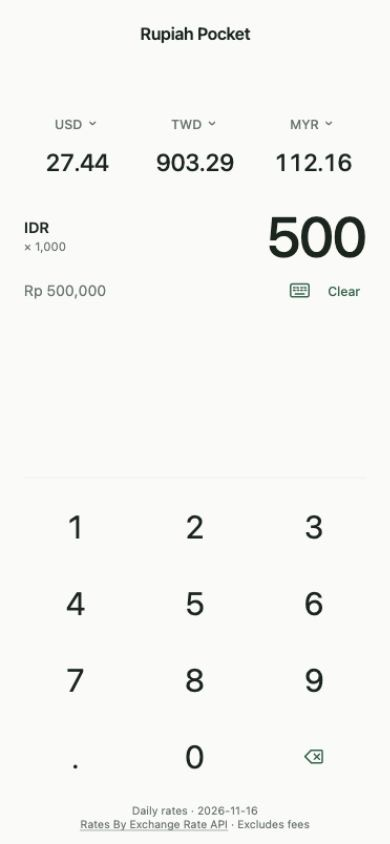

# Rupiah Pocket

A mobile-first currency calculator for travel in Indonesia. Enter a rupiah price, compare it in **1–3 currencies of your choice**, and keep calculating offline.

**[Open Rupiah Pocket](https://rupiah-pocket.pages.dev/)**

## Why

Rupiah prices have a lot of zeros. This tool makes everyday prices easier to understand with fewer taps, a clear IDR input, and quick comparisons in your preferred currencies.

## What it does

- Search and choose up to three currencies; your preferences stay on the device.
- Enter prices with the built-in keypad or optional phone keyboard.
- Refresh daily reference rates online and save the last successful rates for offline use.
- Show the rate date and offline or older-data status.
- Run in a browser or from your phone’s Home Screen, without an account, ads, or tracking.

## Use it

1. Open the app and enter a price. Plain numbers mean **thousands of IDR**: `50` → Rp50,000; `175.5` → Rp175,500. Explicit units such as `150K` mean Rp150,000.
2. Tap a currency code to choose your currencies, then tap **Done**.
3. On iPhone, use Safari’s **Share → Add to Home Screen** to install it. Open it online once before relying on offline use.

Rates come from [ExchangeRate-API](https://www.exchangerate-api.com/), with [currency-api](https://github.com/fawazahmed0/exchange-api) as a fallback. They are daily reference rates and exclude bank/card fees and exchange spreads.



## Development

Plain HTML, CSS, and JavaScript. No dependencies, backend, or build step.

```sh
python3 -m http.server 4173
```

Open http://localhost:4173/. Run the included checks with `node test-amount.mjs` and `node test-rates.mjs`.

Cloudflare Pages deploys pushes to `main` automatically, using build command `exit 0` and output directory `.`. When changing cached app assets, update `VERSION` in `sw.js` so installed copies receive the new shell.
